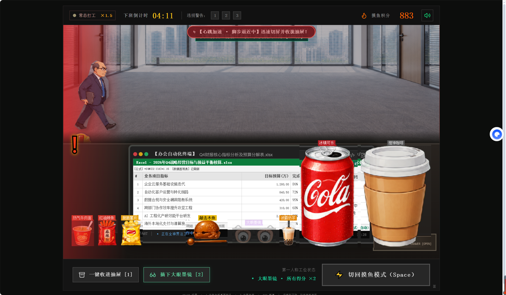

# 假装很忙 · Lazy for Work

一款第一人称办公室摸鱼反应小游戏。老板靠近时切到工作画面，收好桌上的零食，争取准时下班！

**在线试玩：[lazyforwork.aicreatehome.com](https://lazyforwork.aicreatehome.com/)**  
备用地址：[lazyforwork.pages.dev](https://lazyforwork.pages.dev/)



## 玩法

- 选择轻松实习、常态打工或魔鬼周五，点击「打卡开工」开始一局 5 分钟的游戏。
- 摸鱼状态持续得分；巡查时切到工作画面并收起桌面物品，成功伪装可获得奖励。被抓 3 次结束。
- 点击牛肉面、辣条、薯片、奶茶、可乐和咖啡，基础奖励为 5 分；敲击木鱼基础奖励为 10 分。
- 积分奖励乘以当前难度倍率；戴大眼墨镜时，所有获得的积分再翻倍。
- 抽屉收纳所有桌面道具，包括可乐和咖啡；收纳后无法点击物品加分，再次操作即可摆回桌面。

| 操作 | 快捷键 |
| --- | --- |
| 工作 / 摸鱼切屏 | Space 或 Tab |
| 收起 / 摆回全部桌面物品 | 1 |
| 戴上 / 摘下大眼墨镜 | 2 |
| 暂停 / 继续 | Esc |

## 本地运行

需要 Node.js 22 或更新版本。克隆仓库后：

```sh
git clone https://github.com/meggie321/lazyforwork.git
cd lazyforwork
npm install
npm run dev
```

打开终端中显示的本地地址（默认 http://localhost:5180）。此游戏无需 API Key、数据库或后端服务。

```sh
npm test       # 检查开始页、难度、快捷键、全部道具奖励、双倍积分和抽屉收纳
npm run build # 类型检查与生产构建
npm run preview
```

也可以使用 pnpm：`pnpm install --frozen-lockfile && pnpm dev`。

## 部署自己的版本

`npm run build` 生成 `dist/`，可以直接部署到静态托管平台。Cloudflare Pages 支持直接上传该目录：

```sh
npx wrangler login
npx wrangler pages deploy dist --project-name=你的项目名称
```

需要自定义域名时，在自己的 Cloudflare Pages 项目添加域名，并按控制台提示配置 DNS。部署凭据只存放在本地或平台密钥设置中，不提交到仓库。

## 项目结构

- `src/BusyGame.tsx`：游戏状态、老板巡查、计分和界面。
- `src/busy.css`：场景、桌面道具、开始页和响应式布局。
- `public/`：由项目发起者提供的参考图素材；当前场景与道具通过 CSS 从参考图中取用。
- `scripts/check-game-entry.mjs`：游戏交互回归检查。

技术栈：React、TypeScript、Vite、Tailwind CSS、Lucide。

## 使用许可

原创程序代码采用 MIT 许可。参考截图素材及其中的第三方图像、商标不属于代码许可的授权范围，相关权利归各自权利人。

